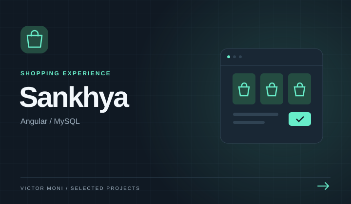

# 🛒 Sankhya

<div align="center">

[]()
[]()
[]()
[](./LICENSE)

</div>

Aplicativo full-stack desenvolvido em **Spring Boot** (Backend) + **Angular** (Frontend) + **MySQL**, com orquestração via **Docker Compose**.
Funcionalidades principais: catálogo de produtos, carrinho, pedidos recentes e checkout.

---

## 📂 Estrutura do Projeto

```
Sankhya/
├── .github               # Workflows e configurações do GitHub Actions
├── backend/              # API Spring Boot
├── frontend/             # Aplicação Angular
├── .gitignore            # Arquivo para ignorar arquivos/pastas no Git
├── CODE_OF_CONDUCT.md    # Guia de conduta para contribuidores
├── CONTRIBUTING.md       # Orientações para contribuir com o projeto
├── docker-compose.yml    # Orquestração dos serviços
├── LICENSE               # Licença de uso do projeto
└── README.md             # Documentação do projeto
```

---

## 🚀 Tecnologias

- **Backend**: Spring Boot 3.4.0, Spring Data JPA, Flyway
- **Frontend**: Angular 20, HTML, SCSS
- **Banco de dados**: MySQL 8 (`utf8mb4`)
- **Infra**: Docker & Docker Compose

---

## 🔧 Como rodar localmente

> Requisitos: [Docker](https://www.docker.com/) e [Docker Compose](https://docs.docker.com/compose/)

```bash
# clonar o repositório
git clone https://github.com/VictorMoni/Sankhya.git
cd Sankhya

# subir os serviços
docker compose up -d --build
```

Depois disso:
- Backend → [http://localhost:8080](http://localhost:8080)
- Frontend → [http://localhost](http://localhost)
- Swagger → [http://localhost:8080/swagger-ui.html](http://localhost:8080/swagger-ui.html)

---

## 🗄️ Migrations & Seeds (Flyway)

A aplicação usa Flyway para criar o schema e popular produtos iniciais:

- **V1__init.sql** → cria tabelas (`products`, `orders`, `order_items`)
- **V2__seed_products.sql** → insere produtos de catálogo com imagens

---

## 🎯 Funcionalidades

- Catálogo de produtos com imagens
- Carrinho persistente (LocalStorage)
- Checkout com validação de estoque
- Histórico e detalhes de pedidos
- Toast de pedido criado com link para `/orders/:id`

---

## 🧪 Testes

- **Backend**: Spring Boot Test (JPA, serviços, REST)
- **Frontend**:
  - Unitários com Karma + Jasmine
  - E2E com Playwright

---

## 🌐 Endpoints principais da API

| Endpoint                          | Método | Descrição                        |
|-----------------------------------|--------|----------------------------------|
| `/api/v1/products?page=0&size=10` | GET    | Lista de produtos paginada       |
| `/api/v1/orders`                  | GET    | Lista de pedidos paginada        |
| `/api/v1/orders/{id}`             | GET    | Detalhe de um pedido             |
| `/api/v1/orders/checkout`         | POST   | Realizar checkout do carrinho    |

---

## 📦 Docker Compose

Serviços incluídos:

- **mysql**: banco de dados com volume persistente
- **backend**: aplicação Spring Boot (porta `8080`)
- **frontend**: aplicação Angular (porta `80`)

O backend só sobe após o MySQL estar saudável.

---

## 📋 Como usar

1. Acesse o frontend em `http://localhost`
2. Navegue no catálogo de produtos
3. Adicione itens ao carrinho
4. Finalize a compra → toast com link para pedido criado
5. Veja pedidos recentes em `/orders`

---

## 🚀 Melhorias futuras

- Autenticação de usuários
- Interface 100% responsiva
- Persistência do carrinho no backend
- Upload de imagens reais para produtos
- Testes de integração mais completos

---

## 📄 Licença

Este projeto está licenciado sob a [MIT License](./LICENSE).
